# Flight Bag

**Flight Bag** is the settings tool shared by [Flight Wingman](https://github.com/Mariator-pro/edgetx-flight-wingman),
[Lipo Nanny](https://github.com/Mariator-pro/edgetx-lipo-nanny), [Link Sentinel](https://github.com/Mariator-pro/elrs-link-sentinel)
and [GPS Homer](https://github.com/Mariator-pro/edgetx-gps-homer). Every one of these projects ships it, so it is on
your SD card as soon as one of them is. Open it on the radio under **SYS → Tools → Apps → Flight Bag**.

Flight Bag writes one `config.lua` per project (in `/SCRIPTS/LIPONY/`, `/SCRIPTS/SNTNL/`, `/SCRIPTS/GPSHOMER/`,
`/SCRIPTS/WINGMAN/`). The widgets and function scripts read it at runtime and pick up saved changes within a few
seconds, so no restart is needed. You never have to edit files on the PC.

All screenshots show a TX16S MK3 with all four projects installed. With fewer projects you see fewer pages and rows.

- [Start page](#start-page)
- [Project popup and resets](#project-popup-and-resets)
- [Warnings](#warnings)
- [Alerts](#alerts)
- [Batteries](#batteries) (Lipo Nanny)
- [Models](#models) (Lipo Nanny, Flight Wingman)
- [Last flights](#last-flights) (GPS Homer)
- [Display](#display) (Flight Wingman, Lipo Nanny)
- [Units](#units)

---

## Start page

The start page lists the topic pages on top and the installed projects as icons below, plus **Exit**.

  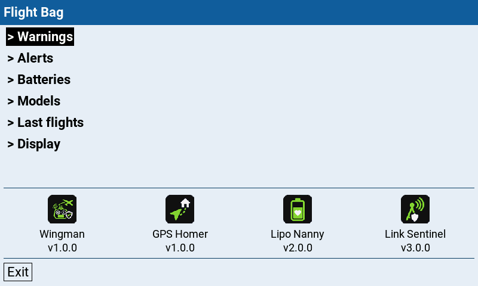

| Page | What it does | Shown with |
|---|---|---|
| **Warnings** | Thresholds of the warnings, one block per project. | Lipo Nanny, Link Sentinel, GPS Homer |
| **Alerts** | Sounds and vibration (shared by all projects), the sound per warning with a **Play** test. | Lipo Nanny, Link Sentinel, GPS Homer |
| **Batteries** | Your battery *profiles* (a type of battery) and their physical *packs*. | Lipo Nanny |
| **Models** | Per model: cell count, single or parallel packs, assigned batteries, sensors, what Wingman shows. | Lipo Nanny, Flight Wingman |
| **Last flights** | Where the model was when the telemetry ended, for the last three flights, with a QR code. | GPS Homer |
| **Display** | What the widgets show (flight time, mascot, GPS view). | Flight Wingman, Lipo Nanny |

Navigation: the rotary wheel moves the cursor, **Enter** opens a page (`>`) or edits a field, **Exit/RTN** goes
back. On touch radios you can also tap the pages and icons of the start page. The line with the **i** at the
bottom explains the selected row.

The pages with settings (Warnings, Alerts, Display) end with **Back** and **Save**. **Save** writes the settings
of every project on the page; **Back** asks before discarding changes.

> **Text entry** (battery name and manufacturer): the wheel walks the character slots; **Enter** on a slot opens
> the character ring (the wheel picks the character, the **MDL** key switches the ring group **ABC** → **abc** →
> **123#**). At the right of the row sit two buttons: **Done** commits, **Clear** (rightmost) empties the field.
> **RTN** discards the edit.

---

## Project popup and resets

Tapping a project icon (or Enter on it) opens a popup with its version, the project link and its buttons:

  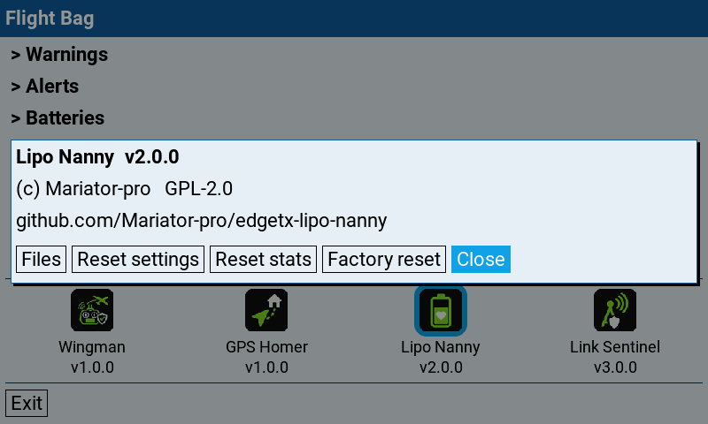

- **Files**: the paths of the project on the SD card.
- **Create**: shown while the project has no settings file yet (a fresh install). It writes the defaults. The
  settings pages (Warnings, Alerts, Display) offer the same button in the project's block.
- **Reset**: shown instead of the resets when the settings file is damaged. It replaces the file with the defaults.
- **Close**.

A **warning sign** on an icon means something needs attention: no settings file yet, a damaged file, a missing
sensor, or a setup step still open (for example no battery assigned to the active model). The popup names it in
the warning colour.

The resets ask for confirmation first. **Sounds**, **Vibration** and **Strength** are shared by all projects, so
no reset changes them.

| Project | Button | What it does |
|---|---|---|
| Lipo Nanny | **Reset settings** | Thresholds, warning sounds and flight time back to the defaults. Batteries, models and statistics stay. |
| Lipo Nanny | **Reset stats** | Zeroes every pack's cycle count and statistics (Life mAh, Vmin, Last used) and empties the archive. Profiles and models stay. |
| Lipo Nanny | **Factory reset** | Erases all batteries, models, statistics and settings. |
| Link Sentinel | **Reset settings** | All Link Sentinel settings back to the defaults. |
| GPS Homer | **Reset settings** | All GPS Homer settings back to the defaults. The flight list stays. |
| GPS Homer | **Clear flights** | Empties the list on the Last flights page. |
| GPS Homer | **Factory reset** | Both of the above. |

Flight Wingman has no resets of its own (its popup shows **Files** and **Close**).

> **Updating from an older version?** Flight Bag replaces the old Tools entries "Lipo Nanny", "Link Sentinel" and
> "GPS Homer" and removes them on first start. If one still shows up, delete `/SCRIPTS/TOOLS/LIPONY.lua`,
> `SNTNL.lua` or `GPSHOMER.lua` by hand.

---

## Warnings

One block per project with its thresholds.

  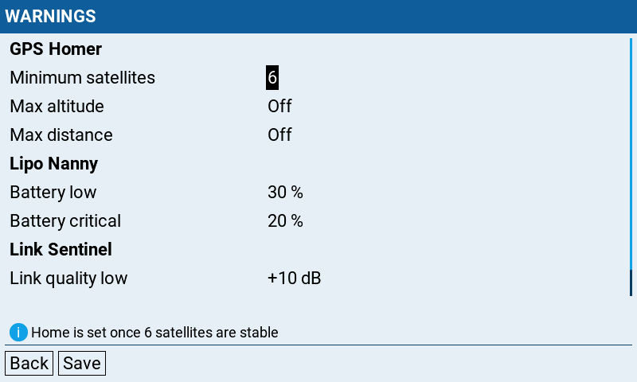

**GPS Homer**

| Row | Notes |
|---|---|
| **Minimum satellites** | How many satellites must be locked before home is set. **4-20** (default 6). Higher gives a more accurate home but sets it a little later. |
| **Max altitude** | `Off` (default) or **10-500** in steps of 10, in the unit of your altitude sensor. Above this height over home the radio says "Maximum altitude" once, and again only after the model has dropped 10 below the limit. With the default ELRS telemetry ratio the altitude arrives only every few seconds, so the warning can come a little late. While above, ALT on the widget turns red. |
| **Max distance** | `Off` (default) or **100-5000** in steps of 100, in m or ft (the radio's units). Farther than this from home the radio says "Maximum distance" once, and again only after the model has come 100 closer. While farther, DIST on the widget turns red. |

**Lipo Nanny**

| Row | Notes |
|---|---|
| **Battery low** | The first warning, default **30 %** remaining (**1-99 %**). |
| **Battery critical** | The second warning, default **20 %** (**1-99 %**). Saving is blocked unless Battery low is above Battery critical. |

A battery profile can override both values (see [Batteries](#batteries)); the profile's values then win.

**Link Sentinel**

| Row | Notes |
|---|---|
| **Link quality low** (Stage 1) | How early the first warning comes, as a margin above the RF mode's sensitivity limit. **10-30 dB** (default 10). Higher warns earlier. |
| **Link quality critical** (Stage 2) | The link quality (RQly) below which the warning turns critical. **30-70 %** (default 42). Higher warns earlier. |

---

## Alerts

The shared rows on top apply to all projects at once, then one block of sound rows per project.

  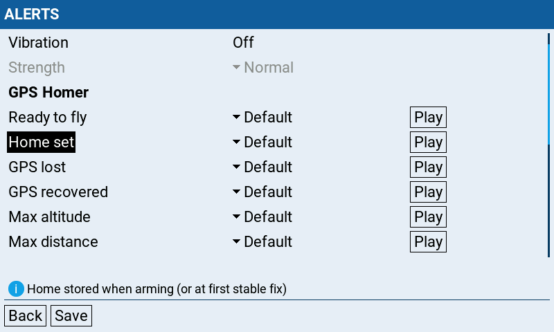

| Row | Notes |
|---|---|
| **Sounds** | `On` (default) / `Off`. **Off** silences every announcement of every project at once; vibration stays. The sound rows are then greyed out. |
| **Vibration** | `On` / `Off` (default **Off**). When on, the radio buzzes with each warning, independent of the sound. Has no effect on radios without a vibration motor. |
| **Strength** | `Soft` / `Normal` (default) / `Strong`, the pulse length. Greyed out while Vibration is off. |

If the projects were set differently before, a shared row shows **Mixed** until you choose a value.

**Sound rows.** Dive into a row to reach the sound and the **Play** button. A sound is **Off**, **Default** (the
bundled WAV) or any `*.wav` you put into the project's sound folder, picked from a list. A selected file that
later goes missing falls back to the default. **Off** silences only that sound; with vibration on, the buzz still
fires. **Play** plays the selected sound (and, with vibration on, its buzz), so you can check that the file is
found and the volume is up. The sound folders always sit under `/SOUNDS/en/`, whatever language the radio uses.

| Project | Sound folder | Rows |
|---|---|---|
| GPS Homer | `/SOUNDS/en/SCRIPTS/GPSHOMER/` | **Ready to fly**, **Home set**, **GPS lost**, **GPS recovered**, **Max altitude**, **Max distance**. Vibration: two pulses for GPS lost, Max altitude and Max distance, one for every other event. These three warnings also switch a dimmed display back on. |
| Lipo Nanny | `/SOUNDS/en/SCRIPTS/LIPONY/` | **Battery low**, **Battery critical** (at the thresholds of the same name), **Battery not charged** (once, when a pack is already below Battery low as it is picked). Vibration: one pulse for Battery low and Battery not charged, two for Battery critical. |
| Link Sentinel | `/SOUNDS/en/SCRIPTS/SNTNL/` | **Link quality low** (Stage 1), **Link quality critical** (Stage 2), plus three that are `Off` by default: **Link lost** (once when the link is gone for 1.5 s during a flight, not after a disarm; `Default` says "Radio link lost", `telelost.wav` says "Radio link telemetry lost"; without `FM` from the flight controller it also plays when you unplug the battery after landing), **Link connected** (once when the link comes up for a new flight), **Link recovered** (once when the link comes back after it was lost during an armed flight). Vibration: one pulse for Stage 1, two for Stage 2. |

---

## Batteries

Lipo Nanny only. The list shows your battery **profiles**; **[+] Add new** creates one. A profile describes a
*type* of battery; each profile owns one or more physical **packs** that you actually fly and that collect cycles.

  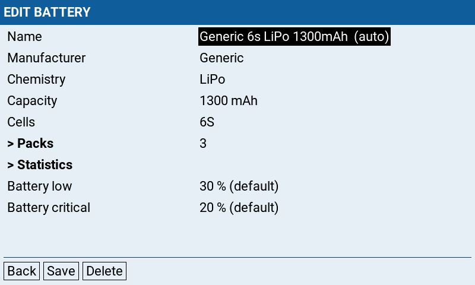

| Field | Notes |
|---|---|
| **Name** | Generated as `<Manufacturer> <S>s <Chemistry> <mAh>mAh` (tagged `(auto)`). Editing it switches to your own name (up to 30 characters); the **Reset name** button brings the generated one back, and so does saving an empty name. |
| **Manufacturer** | Free text, up to **10 characters** (used in the generated name). **Required**: the profile won't save while it is empty. |
| **Chemistry** | `LiPo`, `LiPoHV` or `LiIon`. Selects the resting voltage to charge curve. |
| **Capacity** | Nominal capacity in mAh (**10-50000**). The **MDL** key cycles the step size 10 → 100 → 1000. |
| **Cells** | Cell count (S), **1-30**. Must match the model's cell count to be assignable. |
| **Packs** | Opens the Packs page (see below). |
| **Statistics** | Opens the read-only Statistics page (see below). |
| **Battery low** / **Battery critical** | Per-profile override of the [warnings](#warnings) (**1-99 %**). Shows `… % (default)` until you set one. The two are overridden **as a pair**: once you change one, the other is pinned at its current global value too, so later changes on the Warnings page no longer affect this profile. Dialing both back onto the global values clears the pair. Saving is blocked unless Battery low is above Battery critical. |

Buttons: **Back**, **Save**, **Delete** (existing profiles only) and **Reset name** (only while the name is your own).

### Packs

  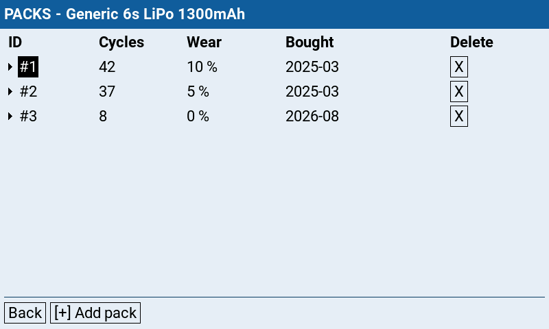

Each row is one physical pack: **ID** (`#1`, `#2`, …), **Cycles**, **Wear**, **Bought** and **Delete**. Select a
row and dive in to edit:

- **Cycles**: the cycle count (**0-9999**). The widget counts it up by itself; edit it here for corrections.
- **Wear**: **0-50 %**. Lowers the pack's *effective* capacity, so an aged pack reaches the warnings **earlier**
  without re-tuning the thresholds.
- **Bought**: an optional purchase month (`YYYY-MM`), shown as `-` until set. The wheel steps one month at a
  time, starting at the current month. Only for your information, to track battery age.
- **Delete** (`X`): archives the pack (its history stays in the statistics). The last pack can't be removed
  (delete the whole profile instead), and a profile used by a parallel model keeps at least two packs.

**[+] Add pack** adds another pack to the profile.

### Statistics

  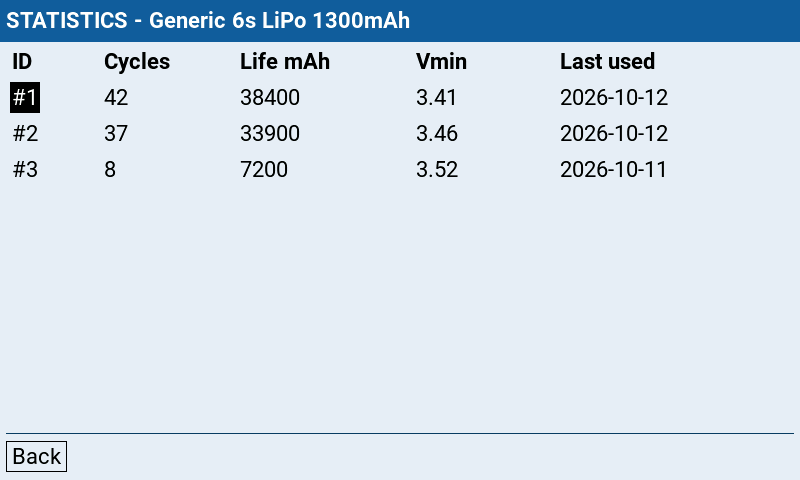

A read-only table, one row per pack, that the widget fills in as you fly:

| Column | Meaning |
|---|---|
| **ID** | The pack label (`#1`, `#2`, …). |
| **Cycles** | The same cycle count as on the Packs page. |
| **Life mAh** | Total consumed mAh over the pack's whole life. |
| **Vmin** | The lowest cell voltage ever seen under load, `-` if never flown. |
| **Last used** | Date of the most recent flight (`YYYY-MM-DD`), or `-`. |

**Reset stats** in the Lipo Nanny popup clears them (together with the cycle counts).

---

## Models

The list shows every configured model; the model loaded on the radio is tagged `[active]`. If it isn't
configured yet, **[+] Add current model** appears in the bottom bar.

  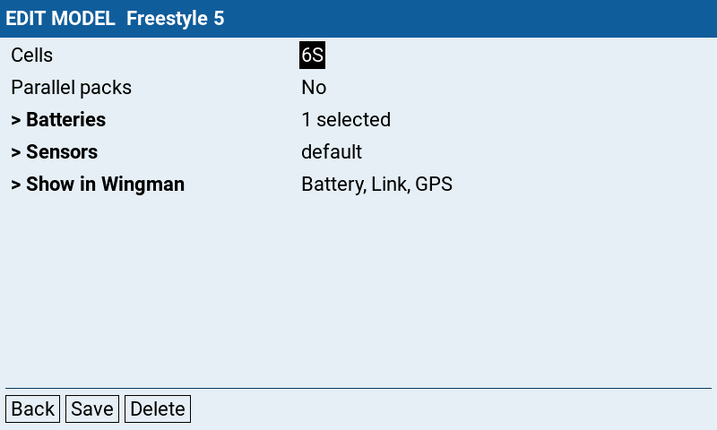

| Field | Notes |
|---|---|
| **Cells** | The model's cell count (S). Only profiles with the same cell count can be assigned. |
| **Parallel packs** | `Yes` if you fly two packs in parallel (shown as `#1+2`), otherwise `No`. Needs at least one assigned profile with **two or more packs**. Switching to `Yes` with single-pack profiles assigned asks to unassign them. At flight time the second pack is always from the same profile as the first. |
| **Batteries** | Opens the list where you tick the profiles that fit this model. Profiles with the wrong cell count (and, in parallel mode, those with fewer than two packs) are greyed out. |
| **Sensors** | `default` or `custom`. Opens the sensor mapping (see below). |
| **Show in Wingman** | Only with Flight Wingman. Opens the module switches (see below). |

Buttons: **Back**, **Save** and **Delete** (existing model settings only).

### Sensors

  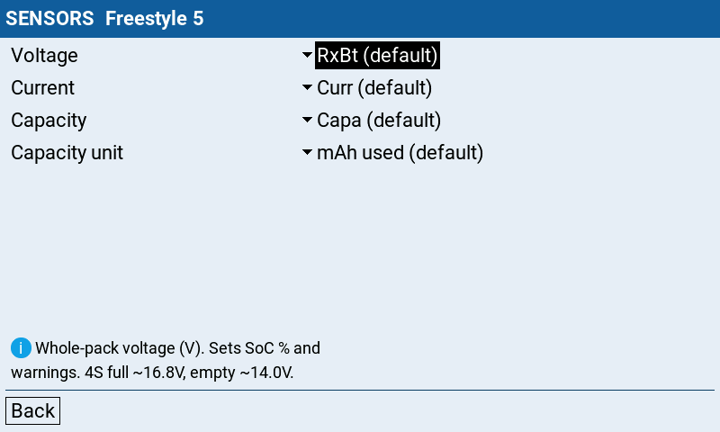

Only needed if you don't use ELRS/CRSF. Lipo Nanny reads three telemetry sensors, plus the unit of the capacity
sensor:

| Sensor | Default | Used for |
|---|---|---|
| **Voltage** | `RxBt` | Resting voltage (charge at plug-in) and the pack and cell voltage. |
| **Current** | `Curr` | Live current draw. |
| **Capacity** | `Capa` | Consumed mAh, the main source of the remaining %. |
| **Capacity unit** | `mAh used` | Set to `% remaining` only if your flight controller sends the remaining percent instead of the consumed mAh. |

Pick each sensor from the list of sensors the radio knows; with the model powered and linked, run **Discover new**
on the model's telemetry page first. Sensors can only be edited for the active model. **Reset to CRSF defaults**
(shown only while a custom mapping is set) restores the default names. The mapping is saved with the model.

> **% remaining:** Lipo Nanny converts the percent into consumed mAh with the capacity of the selected battery
> profile. This is only correct if the battery capacity set in the flight controller is **exactly** the profile's
> capacity (for parallel packs: the sum of both).

### Show in Wingman

  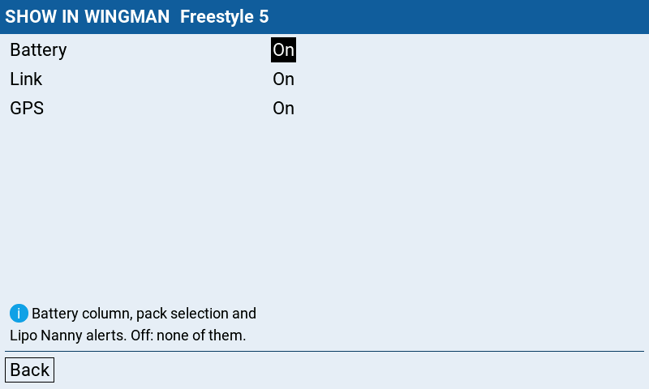

Switches **Battery**, **Link** and **GPS** on or off for this model (default all on). A switched-off column stays
empty in Flight Wingman, is left out of the ready check and frees its space for the others. Switching it off also
stops that project's announcements on this model.

---

## Last flights

GPS Homer only. Where the model was when the telemetry ended, for the last three flights.

  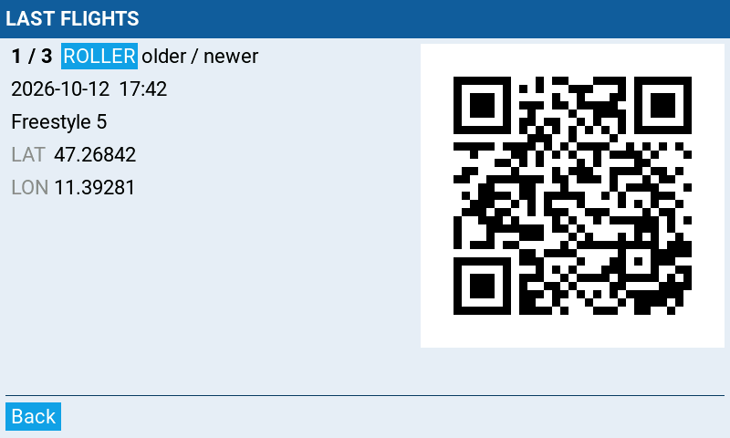

Each entry shows date, time, model name and coordinates, plus a **QR code**: scan it with a phone and the map app
opens on that spot. The wheel steps through the flights (older / newer). **Clear flights** in the GPS Homer popup
empties the list.

---

## Display

What the widgets show.

  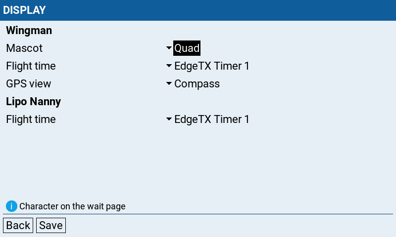

**Flight Wingman**

| Row | Notes |
|---|---|
| **Mascot** | The character on the waiting page, `Quad` (default) or `Scout`. |
| **Flight time** | The small value beside the battery percentage on the flight page: `EdgeTX Timer 1` (default, the model's Timer 1) or `Remaining Timer` (Lipo Nanny's estimate of the remaining flight time, `calc..` for the first 30 s of flying). |
| **GPS view** | The layout of the flight page, `Compass` (default) or `Horizon` (large artificial horizon from the flight controller's pitch and roll). The horizon follows the model smoothly only with **Telem Ratio** 1:4 or faster in the ExpressLRS Lua script (with `Std` it moves only every few seconds). |

**Lipo Nanny**

| Row | Notes |
|---|---|
| **Flight time** | `EdgeTX Timer 1` (default) shows **TIMER** with the model's Timer 1 (nothing while Timer 1 is off); `Remaining Timer` shows **TIME LEFT**, the estimated remaining flight time. Applies to the Lipo Nanny widget; Flight Wingman uses its own row above. |

---

## Units

Flight Bag has no unit setting: units follow the radio (**SYS → Radio setup → Units**). Metric shows m, km and
km/h, imperial ft, mi and mph. Altitude, speed and vertical speed are shown as their sensors deliver them, so with
imperial also set the units of the altitude, speed and `VSpd` sensors on the radio (ft, mph, ft/s); distances are
converted.
