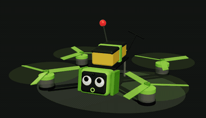
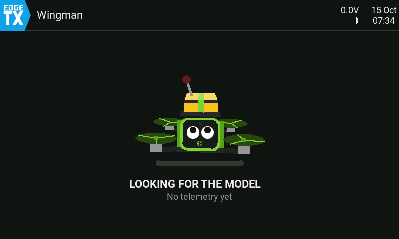
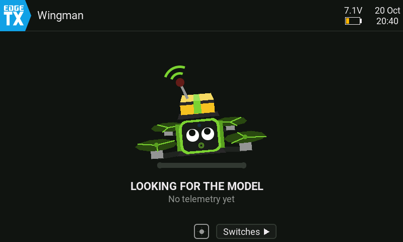
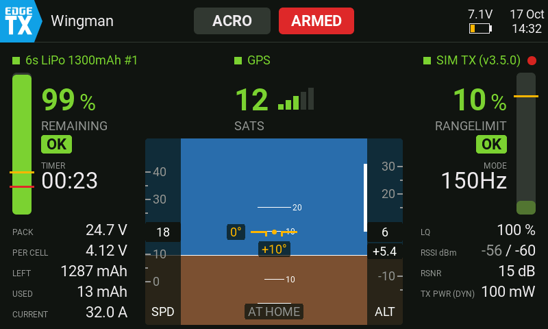
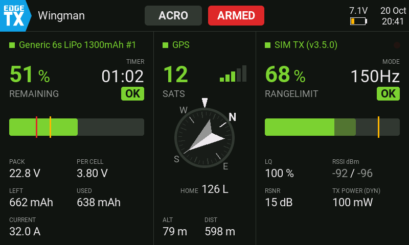
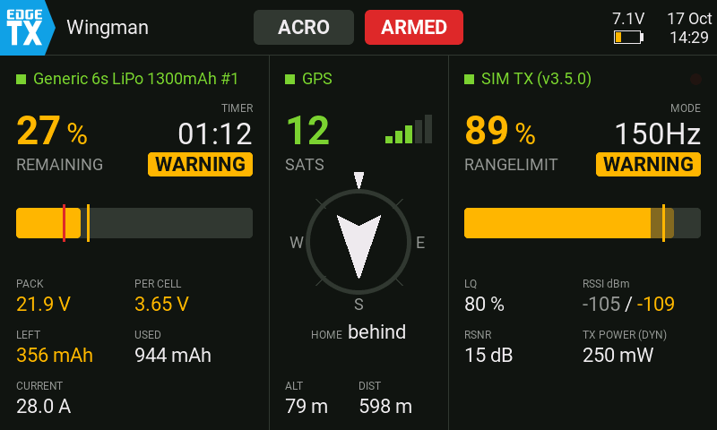
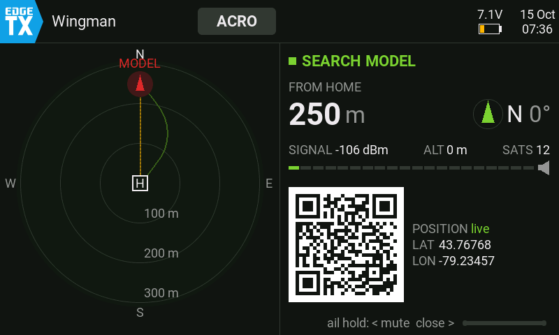

# Flight Wingman in action

Meet **Quad**, the Wingman mascot: it keeps you company on the waiting page and looks sad when something in the setup needs your attention.

  

How the pages of Flight Wingman change during a flight, shown on a TX16S MK3.

  
   <b>A whole flight</b> waiting, preflight, flight, warning, critical, return to home, post-flight and search (time-lapse)

Each phase on its own:

<table>
  <tr>
    <td align="center"></td>
    <td align="center"></td>
  </tr>
  <tr>
    <td align="center"><b>Preflight</b> GPS fix settles, CHECK turns into GO</td>
    <td align="center"><b>Take-off, horizon</b> climb out, speed and altitude tapes</td>
  </tr>
  <tr>
    <td align="center"></td>
    <td align="center"></td>
  </tr>
  <tr>
    <td align="center"><b>Warning</b> weak link and battery below 30 %</td>
    <td align="center"><b>Critical</b> link quality 35 %, battery below 20 %, 4 sats</td>
  </tr>
  <tr>
    <td align="center" colspan="2"> <b>Search</b> walking up to the model, the signal grows (time-lapse, 4 ×)</td>
  </tr>
</table>
